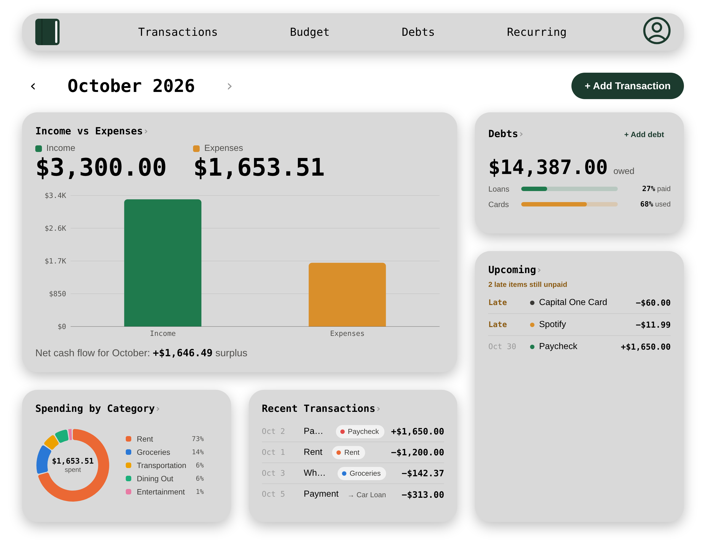
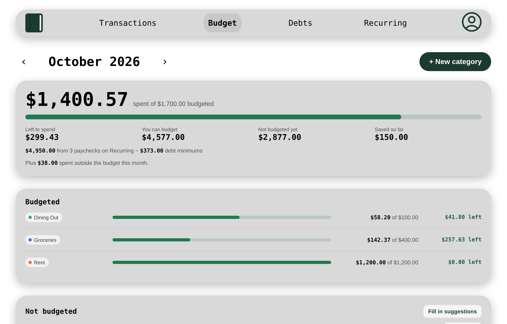
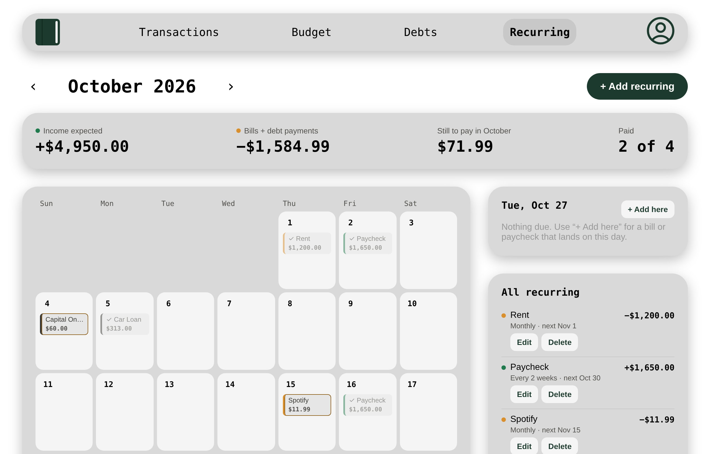
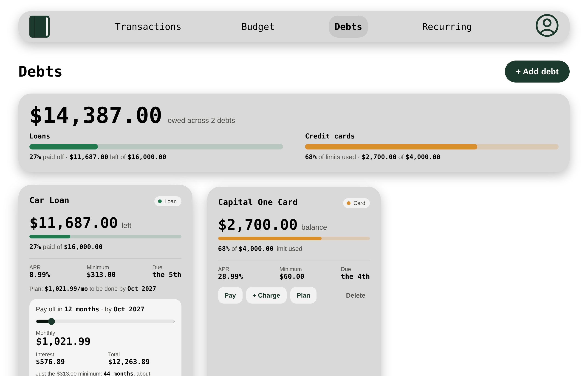
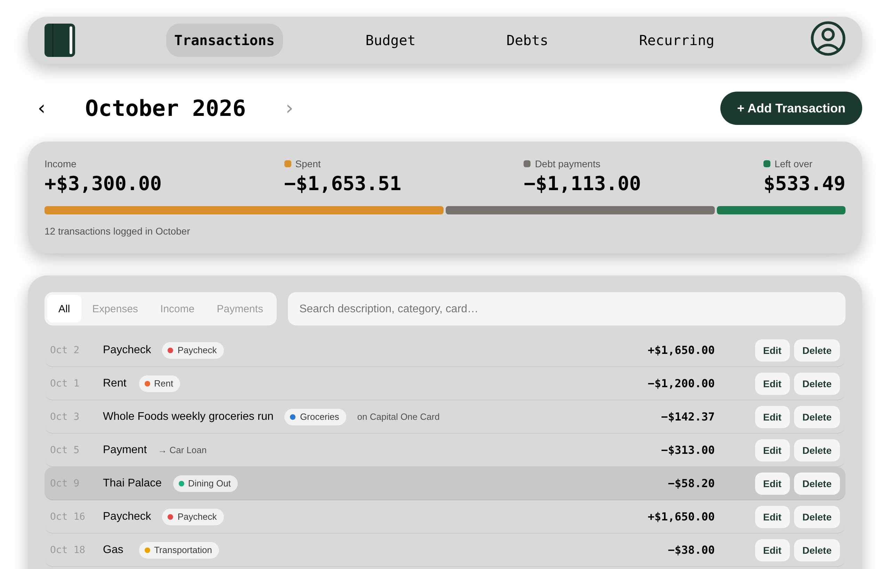
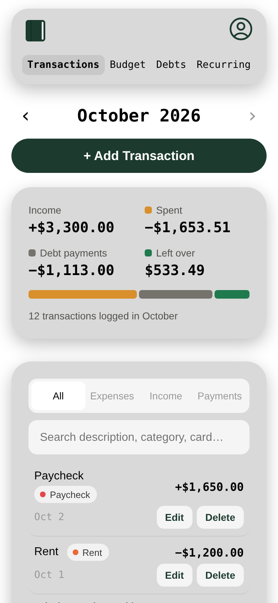
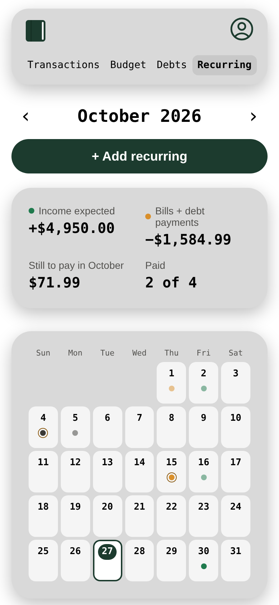
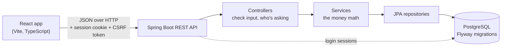

# Ledjr

A personal finance app for keeping track of where your money goes: spending, monthly budgets, debts and recurring bills, all in one place.

[](https://github.com/carascoy/Ledjr/actions/workflows/ci.yml)

**Live demo:** coming soon at [ledjr.dev](https://ledjr.dev)



## What it does

- **Dashboard** with the month at a glance: income vs expenses, spending by category, debts, what's due next and recent transactions.
- **Transactions** you can search, filter, edit and delete. Card purchases and debt payments update the debt's balance automatically.
- **Budgets** per category per month. Ledjr works out how much you *can* budget from your paychecks minus debt minimums, suggests an amount for each category from your recurring bills or your 3 month average, and counts whatever you didn't spend as saved.
- **Recurring bills and paychecks** on a calendar. Mark something paid and it logs the transaction. Credit card and loan minimums show up on their due dates too, and disappear once that month's payments cover them.
- **Debts** with a payoff planner: pick how many months, see the monthly payment and the total interest, compared to just paying the minimum.
- **Optional setup** after sign up (paycheck, bills, debts) that builds your first budget in about a minute.
- **Works on phones.** Every page has a phone and tablet layout.

| Budget | Recurring calendar |
| --- | --- |
|  |  |
| **Debts + payoff planner** | **Transactions** |
|  |  |

<p align="center">
  
  &nbsp;&nbsp;
  
</p>

## Tech stack

| | |
| --- | --- |
| **Backend** | Java 25, Spring Boot 3.5, Spring Security, Spring Session (JDBC), Spring Data JPA / Hibernate |
| **Database** | PostgreSQL 18, schema managed with Flyway migrations |
| **Frontend** | React 19, TypeScript, Vite, React Router, Recharts, plain CSS |
| **Testing** | JUnit 5 (backend), Vitest (frontend), GitHub Actions on every push |
| **Dev setup** | Docker Compose (Postgres + backend + frontend) |

## How it fits together



Controllers only handle requests and validation, services hold the logic, and entities never leave the server: every response is a DTO (a plain record), so things like the password hash can't leak out by accident.

## Things worth a look

Some of the problems that were more interesting than they look:

- **Logins are real sessions, not tokens in localStorage.** Spring Security plus Spring Session keeps sessions in Postgres, so restarting the server doesn't log anyone out. The cookie is `HttpOnly` and `SameSite`, every write needs a CSRF token, and signing in swaps the session id to block session fixation. Wrong passwords are rate limited (5 per account / 20 per IP in 15 minutes), and changing your password signs out your other devices. See [`SecurityConfig`](backend/src/main/java/com/Ledjr/config/SecurityConfig.java), [`AuthController`](backend/src/main/java/com/Ledjr/controller/AuthController.java), [`LoginAttemptLimiter`](backend/src/main/java/com/Ledjr/service/LoginAttemptLimiter.java).
- **Recurring dates don't drift.** A bill on the 31st lands on Feb 28, then goes back to Mar 31, because every date is counted from the start date instead of from the last one. Every-2-weeks paychecks stay on schedule years later. [`RecurringTemplateService.occurrences`](backend/src/main/java/com/Ledjr/service/RecurringTemplateService.java)
- **Card minimums know when they're paid.** Payments are matched to the due date they belong to (oldest first, never counted twice), so two small payments can cover one minimum, a late payment still counts, and paying next month early goes to next month. [`CalendarService`](backend/src/main/java/com/Ledjr/service/CalendarService.java)
- **Nothing is stored that can be worked out.** The calendar, what's been spent, savings and budget suggestions are all calculated from transactions when you ask, so they can't get out of sync with the real data.
- **Money is never a float on the backend.** Amounts are `NUMERIC` in Postgres and `BigDecimal` in Java. The tests even caught a floating point bug in the frontend payoff math (an exact 12 month plan rounding up to 13).
- **Deleting is careful.** Deleting a category keeps its transactions (they become uncategorized). Deleting an account wipes everything in foreign key order inside one transaction, so it either all goes or none of it does.
- **Accessible by default.** Chart colors were checked for contrast and colorblind separation, text meets contrast on the gray cards, and every animation respects `prefers-reduced-motion`.

## Running it locally

You need [Docker](https://docs.docker.com/get-docker/).

```bash
git clone https://github.com/carascoy/Ledjr.git
cd Ledjr
cp .env.example .env     # then set DB_USER and DB_PASSWORD to anything you want
./dev-up.sh              # docker compose up --build
```

Then open **http://localhost:5173** and sign up. Postgres, the backend (port 8080) and the frontend all start together, and Flyway creates the tables on the first run.

| Script | What it does |
| --- | --- |
| `./dev-up.sh` | build + start everything |
| `./dev-down.sh` | stop everything (keeps your data) |
| `./dev-reset.sh` | stop, **delete the database**, start fresh |
| `./db-up.sh` | just Postgres, for running the backend or frontend outside Docker |

<details>
<summary>Running without Docker (except the database)</summary>

```bash
./db-up.sh

# backend: needs Java 25 + Maven. copy backend/.env.example to backend/.env and set
# DB_URL=jdbc:postgresql://localhost:5432/ledjr plus the same user/password
cd backend && mvn spring-boot:run

# frontend: needs Node 24 (or npm 11+)
cd frontend && npm install && npm run dev
```
</details>

### Environment variables

| Variable | Where | Default | What it's for |
| --- | --- | --- | --- |
| `DB_URL`, `DB_USER`, `DB_PASSWORD` | backend | none | Postgres connection |
| `FRONTEND_ORIGIN` | backend | `http://localhost:5173` | the one site allowed to call the API (CORS) |
| `COOKIE_SECURE` | backend | `false` | `true` once the site is on https |
| `RESEND_API_KEY`, `MAIL_FROM` | backend | none | sends real emails (password reset). Without a key, emails are printed to the backend log |
| `TRUST_PROXY` | backend | `false` | `true` behind a proxy like Heroku's router, so the login limiter sees real IPs |
| `VITE_API_URL` | frontend | `http://localhost:8080` | where the backend lives, baked in at build time |

## Tests

```bash
cd backend && mvn test           # 46 JUnit tests
cd frontend && npm test          # 22 Vitest tests
```

The backend tests cover the parts where a mistake costs someone money or their account: recurring dates, card minimums, budget math, the login limiter, password reset links, reading the real IP behind a proxy, deleting things and the password rules. They use small hand-written fakes instead of a mocking library, so they run in seconds with no database. GitHub Actions runs both suites, plus lint and a production build, on every push.

## Project layout

```
backend/
  src/main/java/com/Ledjr/
    controller/    REST endpoints
    service/       business logic + money math
    repository/    Spring Data JPA queries
    entity/        database tables as Java classes
    dto/           what goes over the wire
    config/        security, CORS, sessions
  src/main/resources/db/migration/   Flyway migrations (V1 to V19)
  src/test/        JUnit tests
frontend/
  src/
    pages/         one per route
    components/    shared pieces (forms, charts, pickers)
    context/       signed in user + selected month
    api/           fetch wrapper (cookies, CSRF, 401 handling)
    utils/         dates, payoff math, recurring helpers (+ tests)
    styles/        plain CSS, one file per page
.github/workflows/ci.yml
docker-compose.yml
```

## What's next

- [ ] Deploy to [ledjr.dev](https://ledjr.dev)
- [x] Forgot password
- [ ] Email verification

---

Built by [carascoy](https://github.com/carascoy). Not affiliated with any other app called Ledjr.
